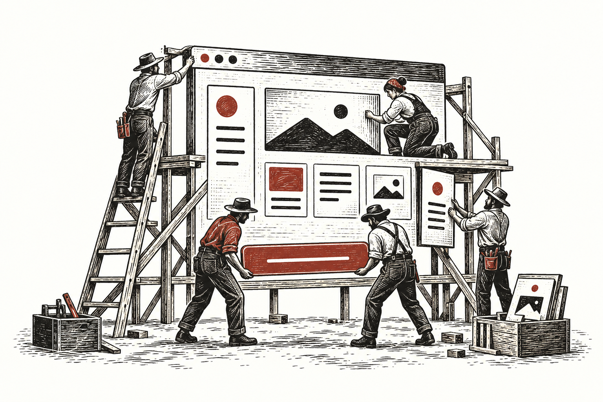

  

**Desenvolvedor Front-end**

Trabalho com front-end desde 2009. Desenho fluxos, escrevo código e acompanho o produto em uso.

`Angular` · `TypeScript` · `RxJS`

- [Trade Arena](https://andre.is-a.dev/?utm_source=github&utm_medium=referral#momento-2025) — desenvolvo as interfaces de ligas e torneios.
- [Acordim](https://andre.is-a.dev/?utm_source=github&utm_medium=referral#frame-nos-apresentacao) — criei um app para dividir as contas de casa e ver quanto cada pessoa ainda precisa acertar.
- [waka’wã](https://andre.is-a.dev/?utm_source=github&utm_medium=referral#frame-wakawa-apresentacao) — estou construindo um navegador para Windows que reúne a página, o código do projeto e o Codex na mesma janela.

[LinkedIn ↗](https://www.linkedin.com/in/andrexdev/) · [Conversar ↗](mailto:andrexduarte@gmail.com)
